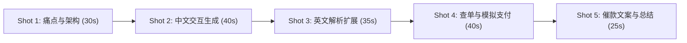

# 小卖家收款助手 (Small Seller Payment Assistant)

> PayPal AI Hackathon 参赛项目：为小微卖家、独立手作人及跨境个人商家打造的自然语言收款与对账助手。说一句话，AI 即刻解析并生成 PayPal 官方收款链接，支持实时查到账与一键生成催款文案。

---

## 目录
- [1. 项目简介](#1-项目简介)
- [2. PayPal API 选型与技术调研](#2-paypal-api-选型与技术调研)
- [3. 本地快速运行指南](#3-本地快速运行指南)
- [4. 获取 PayPal Sandbox 凭据指引（Boss 自行操作）](#4-获取-paypal-sandbox-凭据指引boss-自行操作)
- [5. 3分钟路演视频录制分镜头脚本 (~5 Shots)](#5-3分钟路演视频录制分镜头脚本-5-shots)
- [6. 提交前 Checklist（Boss 待办事项）](#6-提交前-checklistboss-待办事项)
- [7. 项目代码结构](#7-项目代码结构)

---

## 1. 项目简介

### 痛点背景
海量小微卖家、独立手作创作者、自由职业者在微信、WhatsApp、Instagram Direct 等即时通讯工具中与客户达成交易意向后，传统的收款流程非常割裂：
1. 需要手动登录 PayPal 后台配置复杂的商品与账单参数；
2. 缺乏便捷的异步付款链接生成手段；
3. 买家迟迟不付款时难以追踪状态，催款文案组织费时费力。

### 核心功能
- **一句话生成收款链接**：支持中英文自然语言输入（如：“给客户 A 发 50 美元的付款链接，卖的是手工皮包”），自动抽取客户、金额、币种与商品信息。
- **PayPal Invoicing 官方直连**：调用 PayPal Invoicing API v2 生成安全合规的公开账单付款链接。
- **实时查到账**：单据状态跟踪，一键查询买家是否完成支付（`UNPAID` / `PAID`）。
- **智能催款文案**：一键生成得体礼貌的催款草稿（中英双语），无需向外部发信，供卖家快速复制发送至聊天软件。
- **开箱即用 Mock 模式**：未配置密钥时自动启动模拟演示模式，提供“模拟买家已付款”测试按钮，方便评审与快速演示。

---

## 2. PayPal API 选型与技术调研

### 选型对比：Invoicing API v2 vs Orders API

| 维度 | Invoicing API v2 (本项目选用 ⭐) | Orders API |
| :--- | :--- | :--- |
| **主要定位** | 面向商家的异步开单、账单发送与对账 | 面向独立站/电商购物车的即时结账会话 |
| **付款链接时效** | **长期有效**，非常适合直接粘贴到聊天工具 | **短期失效**（通常几小时），要求即时结账 |
| **买家支付体验** | 打开后展示明细账单，支持信用卡与 PayPal 支付 | 重定向至授权结算页，需配合商户前端 capture |
| **状态查询追踪** | **原生支持完整生命周期** (`SENT` -> `PAID`) | 必须由商户服务器监听 Webhook 或执行 Capture |
| **契合度** | **100% 契合小卖家场景**：直接开单并催付 | 适合网站嵌入式结账，对单条聊天链接不友好 |

**结论**：选择 **PayPal Invoicing API v2**。它天然生成可分享的 `https://www.sandbox.paypal.com/invoice/p/#...` 账单链接，且支持直接通过 `GET /v2/invoicing/invoices/{id}` 轮询支付状态，完全免除了搭建复杂 Webhook 和独立结账页的负担。

### 沙箱端点与 OAuth2 认证流程

#### 1. OAuth2 Token 获取 (Client Credentials)
- **Endpoint**: `POST https://api-m.sandbox.paypal.com/v1/oauth2/token`
- **Headers**:
  ```http
  Authorization: Basic <base64(PAYPAL_CLIENT_ID:PAYPAL_CLIENT_SECRET)>
  Content-Type: application/x-www-form-urlencoded
  ```
- **Body**: `grant_type=client_credentials`
- **Response**: 返回 `access_token`，应用内部自动缓存并根据 `expires_in` 刷新。

#### 2. 创建账单 (Create Invoice)
- **Endpoint**: `POST https://api-m.sandbox.paypal.com/v2/invoicing/invoices`
- **Headers**: `Authorization: Bearer <access_token>`, `Content-Type: application/json`
- **Body**: 包含币种、商品名、单价、买家姓名等字段。

#### 3. 获取可分享收款链接 (Send Invoice without Email)
- **Endpoint**: `POST https://api-m.sandbox.paypal.com/v2/invoicing/invoices/{invoice_id}/send`
- **Headers**: `Authorization: Bearer <access_token>`, `Content-Type: application/json`
- **Body**: `{ "send_to_recipient": false }`
- **说明**: 传递 `send_to_recipient: false` 会激活该账单但**不发送真实邮件给买家**，PayPal 返回可供卖家自由分发的永久付款链接（`href`）。

#### 4. 状态查询 (Get Invoice Status)
- **Endpoint**: `GET https://api-m.sandbox.paypal.com/v2/invoicing/invoices/{invoice_id}`
- **Headers**: `Authorization: Bearer <access_token>`
- **Response**: 返回账单当前状态（`DRAFT`, `SENT`, `PAID`, `CANCELLED` 等）。

---

## 3. 本地快速运行指南

### 环境要求
- Node.js >= 18.0.0 (支持内置 `fetch`)
- npm

### 运行步骤
```bash
# 1. 进入应用目录
cd app

# 2. 安装依赖 (仅 express 一个依赖)
npm install

# 3. 启动服务 (默认使用 Mock 模式，无需任何配置)
npm start
```
打开浏览器访问：`http://localhost:3000`

### 环境变量配置（可选，接入真实 PayPal 沙箱时使用）
若需连通官方沙箱：
1. 复制配置模板：
   ```bash
   cp .env.example .env
   ```
2. 编辑 `.env` 文件，填入你的 Sandbox 凭据：
   ```env
   PAYPAL_CLIENT_ID=你的沙箱_CLIENT_ID
   PAYPAL_CLIENT_SECRET=你的沙箱_CLIENT_SECRET
   PORT=3000
   ```
3. 重启应用 `npm start`，界面顶部横幅将自动从 `MOCK MODE` 变为 `SANDBOX CONNECTED`。

---

## 4. 获取 PayPal Sandbox 凭据指引（Boss 自行操作）

> [!IMPORTANT]
> **安全声明**：PayPal 官方账号及沙箱凭证属于个人敏感凭据，请 Boss 本人按以下指引自行在官网申请，**切勿将任何账号密码或真实密钥提交至 Git 仓库**。

### 详细步骤：
1. **登录开发者平台**：使用现有的 PayPal 账号登录 [https://developer.paypal.com](https://developer.paypal.com)。
2. **进入应用列表**：在顶部导航点击 **Dashboard** -> 左侧菜单进入 **Apps & Credentials**。
3. **切换环境**：确保顶部处于 **Sandbox** 标签页。
4. **创建沙箱应用**：
   - 点击 **Create App**。
   - App Name 填写：`SellerAssistantApp`（任意名称均可）。
   - App Type 选择：**Merchant**。
   - Sandbox Business Account：选择系统默认分配的沙箱测试商家账户。
   - 点击 **Create App** 保存。
5. **获取密钥**：
   - 在应用详情页中，即可看到 **Client ID** 和 **Secret**（点击 Show 展开）。
   - 将这两项复制到项目 `app/.env` 中对应的变量即可。

---

## 5. 3分钟路演视频录制分镜头脚本 (~5 Shots)

> **视频时长目标**：2 分 15 秒 ~ 2 分 45 秒（严格控制在 3 分钟以内）  
> **准备工具**：OBS / 剪映 / QuickTime 录屏，麦克风，打开 `http://localhost:3000`。



### Shot 1: 开场引入与痛点（0:00 - 0:30）
- **画面**：展示应用主界面，顶部显著标识 `小卖家收款助手` 与模式状态栏。
- **解说词**：“在跨国小微电商和个人手作交易中，卖家通常在聊天软件里和买家沟通。但每当要收款时，登录后台填表、发账单非常繁琐。今天我们带来这款基于 PayPal Invoicing API 的‘小卖家收款助手’，让卖家只用说一句话，就能完成收款开单、对账与催款全流程。”

### Shot 2: 中文自然语言开单演示（0:30 - 1:10）
- **画面**：在聊天输入框键入：`给客户 A 发 50 美元的付款链接，卖的是手工皮包`，点击发送。界面立即展示智能提取的元数据卡片（客户、金额、商品），并生成带有复制按钮的 PayPal 官方账单链接。
- **解说词**：“看，卖家只需输入日常口语，助手立即提取出客户 A、50 美元和手工皮包，并通过 Invoicing API v2 生成了专属账单链接。卖家点击一键复制，就能直接发给买家。”

### Shot 3: 跨语言与英文场景演示（1:10 - 1:45）
- **画面**：点击快捷示例或输入：`Send a $75 payment link to Bob for ceramic mug`，展示英文语句秒级解析与第二张账单生成。简要展示代码中的 `parseWithLLM` 扩展插槽。
- **解说词**：“系统不仅支持中文，也能完美识别英文指令。我们在底层设计了标准的 LLM Hook，未来可无缝平替为大模型 Function Calling，适应更复杂的多轮上下文对话。”

### Shot 4: 状态跟踪与模拟买家支付（1:45 - 2:25）
- **画面**：
  1. 点击“🔄 查到账”，展示当前状态为待支付（`UNPAID`）。
  2. 点击“⚡ 模拟买家已付款”（Mock Mode 演示功能）。
  3. 状态徽章立即变为绿色的“✓ 已到账 PAID”，右侧历史列表同步变绿。
- **解说词**：“链接发给买家后，卖家无需反复登录后台对账，点击‘查到账’即可实时同步 PayPal 支付状态。在 Demo 环境中，我们内置了模拟买家付款功能，状态瞬间翻转为已到账，完成交易闭环。”

### Shot 5: 智能催款草稿与收尾总结（2:25 - 2:50）
- **画面**：点击“💬 生成催款提醒”，展开双语温和专业的催款文案，点击复制文案。
- **解说词**：“如果买家迟迟未付，助手还能根据商品和金额自动起草得体的催款文案，卖家一键复制即可送达客户，不伤客情。这就是小卖家收款助手，让微小商业收款更轻松、更智能。谢谢大家！”

---

## 6. 提交前 Checklist（Boss 待办事项）

在 11 月 12 日截止前，Boss 需要亲自完成以下事项：

- [ ] **1. 创建公开 GitHub 仓库**
  - 在 GitHub 上新建一个公开（Public）仓库。
  - 将当前项目代码提交并推送到该仓库：
    ```bash
    git init
    git add .
    git commit -m "Initial scaffold: PayPal AI Hackathon seller assistant"
    git branch -M main
    git remote add origin <Boss的公开仓库URL>
    git push -u origin main
    ```
  - **检查**：确认 `.env` 文件已被 `.gitignore` 忽略，未泄露任何个人凭据。
- [ ] **2. 录制并上传演示视频**
  - 参考上述 [第5节分镜头脚本](#5-3分钟路演视频录制分镜头脚本-5-shots) 录制演示视频。
  - 视频长度务必**在 3 分钟以内**。
  - 上传至 YouTube（设为 Unlisted 或 Public）或 Vimeo / Bilibili，获取可访问链接。
- [ ] **3. 在 Devpost 提交项目**
  - 登录 Hackathon Devpost 提交页面。
  - 填写项目名称、简介与核心亮点（可直接引用本 README 第 1、2 节）。
  - 粘贴公开 GitHub 仓库链接与视频播放链接。

---

## 7. 项目代码结构

```text
paypal-ai-hackathon/
├── GOAL.md                 # Hackathon 目标说明
├── README.md               # 本项目详细文档、API 选型报告与路演脚本
└── app/                    # 完整可运行应用目录
    ├── package.json        # 依赖配置文件 (仅 express 单一依赖)
    ├── .env.example        # 环境变量模板 (严禁提交实际密钥)
    ├── server.js           # Express 后端服务及 API 路由实现
    ├── paypal.js           # PayPal Invoicing API 客户端与 Mock 仿真引擎
    ├── parse.js            # 中英文自然语言解析器与 parseWithLLM 预留钩子
    └── public/
        └── index.html      # 单页聊天 UI（原生 HTML/CSS/JS，无构建步骤）
```
